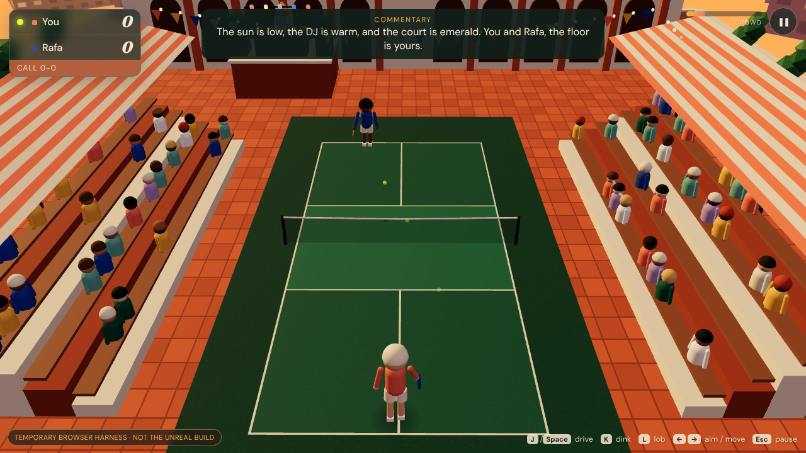

# Rally Club

A Wii Sports–inspired social racket-sports game set in luxury country clubs: motion-controlled phones,
golden-hour rooftop courts, a live DJ, a reactive crowd and charismatic commentary. Original IP.

This directory is the **P1 vertical slice**: Sunset Rooftop Club pickleball.

> **What runs today, and what doesn't.** This environment has **no Unreal Engine and no GPU**, so per
> brief §7 the playable slice is a **clearly labelled temporary browser harness** (`/web`, Three.js).
> The Unreal Engine 5 project (`/unreal`) has full C++ source; its engine-agnostic gameplay core is
> **compiled and tested here with g++**, but the UE gameplay module (actors, subsystem, DJ, crowd,
> camera) has **not been compiled** — that needs a machine with Unreal installed. See
> [docs/FEATURE_STATUS.md](docs/FEATURE_STATUS.md) for the exact implemented / tested / blocked / planned table.



## Quick start

```bash
cd rally-club
bash scripts/setup.sh        # npm install + builds the C++ core tests (Node >= 22.18, CMake, C++17)
npm run dev                  # play at http://localhost:5173 (also reachable from your phone on the LAN)
```

| Command | What it does |
| --- | --- |
| `npm run dev` | Vite dev server for the browser harness |
| `npm run build` / `npm run preview` | Production build to `dist/web` / serve it on :4173 |
| `npm run typecheck` | `tsc` over shared core, harness, tests |
| `npm test` | Unit tests (rules, physics, shot solver, match loop, AtmosphereDirector, commentary) — `node --test` |
| `npm run test:core-cpp` | Builds `unreal/CoreTests` with CMake (`-Wall -Wextra -Werror`) and runs the C++ core tests |
| `npm run test:parity` | Runs 6 full AI-vs-AI matches in **both** the TS and C++ cores and diffs them (must be identical) |
| `npm run test:e2e` | Headless-Chromium acceptance suite (needs `npm run build` first); saves `docs/screenshots/*` |
| `npm run check` | typecheck + unit + C++ core + parity |
| `npm run soak` | Headless AI-vs-AI games with rally statistics |

### Controls (fallback input — phone motion controllers arrive in P2)

| Action | Keyboard | Gamepad | Touch |
| --- | --- | --- | --- |
| Swing — drive / serve | `J` or `Space` | A | **Swing** |
| Dink (soft, into the kitchen) | `K` | B | **Dink** |
| Lob | `L` | Y | **Lob** |
| Aim / move | `←` `→` (`A` `D`); `↑` `↓` (`W` `S`) in Precision | left stick | ◀ ▶ |
| Pause | `Esc` / `P` | — | ❚❚ |

Assist modes (Settings → Gameplay): **Casual** (auto-move, generous timing, waits for required bounces,
never volleys from the kitchen), **Classic** (Wii-like auto-move), **Precision** (manual movement, tight timing).
Timing: press swing about 0.15 s before the ball reaches you; contact happens at the ball's closest approach.

QA URL parameters: `?autoplay` (AI vs AI), `?start=match|practice`, `?seed=N`, `?points=N`,
`?assist=casual|classic|precision`, `?gfx=low|medium|high`, `?speed=N` (sim steps per frame), `?mute` (no TTS).

## Repository layout

```
rally-club/
  shared/      Engine-agnostic TypeScript core: court geometry, ball physics, shot solver, pickleball rules,
               MatchSim (120 Hz match loop), AI, AtmosphereDirector event bus, commentary engine
  web/         TEMPORARY browser gameplay harness (Three.js + Web Audio) — renders the shared core
  unreal/      Unreal Engine 5 project: Core/ (C++ port of the shared core, compiled + tested here),
               UE gameplay module (GameMode, pawn, ball, AtmosphereDirector subsystem, DJ booth with
               Quartz/MetaSounds, instanced crowd, broadcast camera), Automation tests, CoreTests (CMake)
  controller/  P2: phone controller mobile web app (planned — README describes the design)
  server/      P2/P5: controller relay + session authority (planned — README describes the design)
  tests/       unit/ (node:test), e2e/ (Playwright acceptance suite)
  docs/        Feature status, architecture, QA checklist, asset licensing ledger, performance budgets, screenshots
  scripts/     setup, soak, parity, C++ core test runner
```

## P1 acceptance

**"User can complete a scored rally"** — verified by `tests/e2e/smoke.mjs` test 2: a real keyboard `J`
press serves, the rally plays out against the club AI, and the score/server changes. Last run: **6/6 e2e
passed** (see `docs/FEATURE_STATUS.md` → Test results for the exact commands and outputs).

## Reference & provenance

The user-supplied *Rooftop Rally* screenshot (posted by @morenicksaraev, crediting @chongdashu) was used
only as a mood reference — elevated broadcast camera, readable emerald court, warm cast shadows, cosy
diorama scale. No assets, code or branding were copied; every model, texture, sound and line of
commentary here is procedurally generated or original (see `docs/ASSET_LICENSING.md`).
